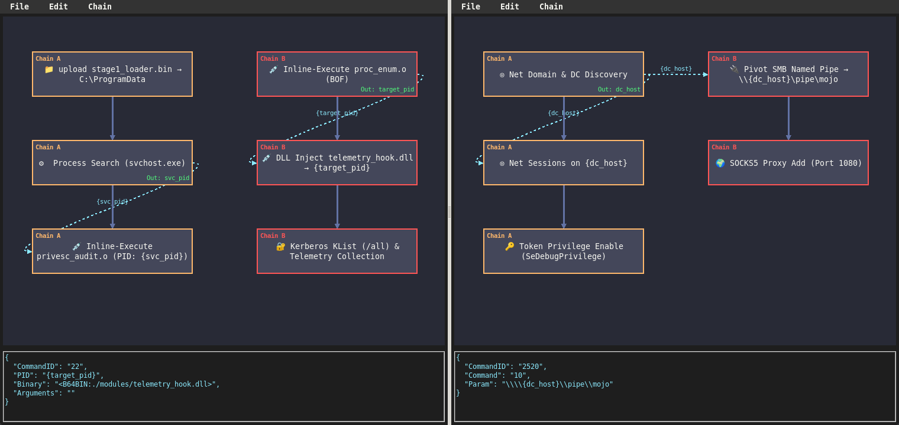
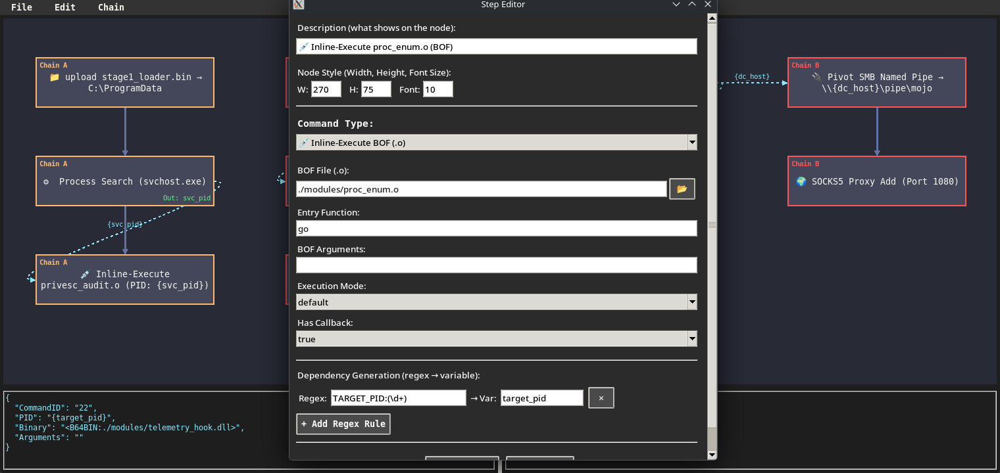
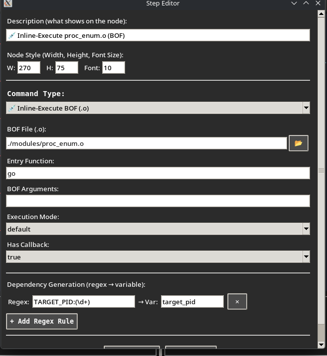
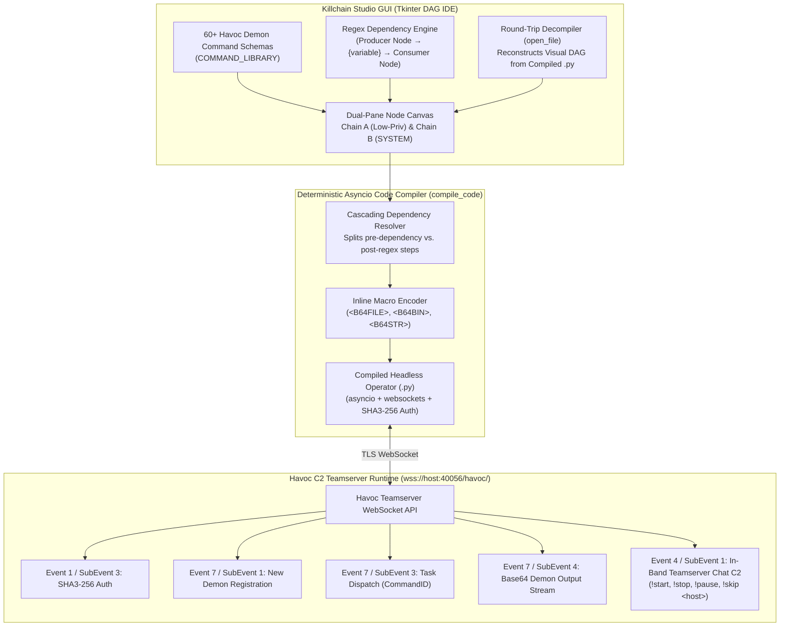

# Killchain Studio — Visual DAG Post-Exploitation Compiler & Adversary Emulation IDE for Havoc C2

[](#system-architecture)
[](#havoc-c2-websocket-protocol--command-schema)
[-00ccff?style=flat-square)](#why-deterministic-dag-compilation-over-llm-agents)
[](#defensive--soc-detection-engineering-purple-team-guide)

> [!IMPORTANT]
> **Purple Team & Adversary Emulation Disclaimer**: Killchain Studio is a visual workflow compiler and protocol research IDE designed to automate reproducible post-exploitation attack chains against the open-source [Havoc C2 Framework](https://github.com/HavocFramework/Havoc) in isolated lab environments. This repository contains **only** the Tkinter visual graph IDE, the asynchronous WebSocket Python compiler, and example JSON workflow graphs—no binary payloads, Beacon Object Files (`.o`), shellcode (`.bin`), or evasion modules are included.



---

## Overview

**Killchain Studio** is a standalone visual node-based IDE (`Python` / `Tkinter`) that compiles drag-and-drop workflow graphs into **asynchronous, headless Python client scripts** (`asyncio` + `websockets`).

### Solving the Go Teamserver vs. Embedded Scripting Bottleneck
While the core Teamserver is written in **Go** and the desktop client is built in **C++/Qt**, its embedded internal Python console API is tightly coupled to the GUI thread—making automated on-checkin workflows unreliable and prone to race conditions.
1. **Externalizing Automation via Raw WebSocket JSON**: By reverse-engineering the undocumented JSON schemas sent between the Qt client and the Go Teamserver (`COMMAND_LIBRARY`), Killchain Studio moves workflow automation completely **outside** the client console.
2. **No-Code Visual Workflow Builder**: Users visually chain steps from 60+ pre-mapped command templates across two privilege tracks—**Chain A (Standard User Context)** and **Chain B (Elevated Context)**—and define regex extractors (`{svc_pid}`, `{target_pid}`, `{dc_host}`) without writing boilerplate code.
3. **The Headless "Phantom Operator" Daemon**: Clicking **Compile As (`.py`)** exports a standalone Python script that authenticates directly to the Go Teamserver over WebSocket (`wss://`) as an independent virtual operator (`PhantomOP`). Whenever a new session event arrives, the virtual operator automatically dispatches the workflow, waits for asynchronous output frames to resolve regex variables, and listens to the in-band team chat for live control commands (`!start`, `!stop`, `!pause`, `!skip <host>`).

---

## Visual IDE & Node Editor Showcase

| Multi-Project Split-Pane Graph Canvas | Dynamic Command & Regex Dependency Editor |
| :---: | :---: |
|  |  |
| *Side-by-side multi-project workspace comparing a Host Privilege Escalation & Telemetry Chain (Left) against an Active Directory Lateral Movement & SMB Named-Pipe Pivot Chain (Right).* | *Step Editor configuring an inline BOF execution (`CommandID: 20`) with a live Regex Output Extractor (`TARGET_PID:(\d+)` → `{target_pid}`) that automatically wires a cyan dependency edge to downstream nodes.* |

---

## Why Deterministic DAG Compilation Over LLM Agents?

While modern offensive tooling increasingly relies on Large Language Models (LLMs) to drive C2 sessions, LLM-driven agents suffer from three critical flaws during structured adversary emulation and Purple Team detection engineering:
1. **Non-Determinism & Hallucinations**: When a SOC Detection Engineer is validating a new Sigma rule, Sysmon configuration, or EDR behavioral alert, the emulated attack chain must execute identically across 100 test runs. LLMs hallucinate syntax, deviate from sequence constraints, and introduce variable latency.
2. **Beacon Sleep / Jitter Race Conditions**: In real C2 architectures, beacons operate asynchronously with sleep intervals and jitter (e.g., 60s sleep / 50% jitter). Firing a 5-step command chain blindly causes downstream commands to execute before upstream prerequisites finish—or before a dependent PID, LUID, or hostname has even been returned.
3. **Zero-Dependency Headless Speed**: Killchain Studio compiles visual graphs directly into native `asyncio` state machines that react within milliseconds of a Teamserver WebSocket frame (`Event: 7`, `SubEvent: 4`), pausing downstream execution at exact dependency gates until regex-extracted runtime variables populate.

---

## System Architecture & Compiler Pipeline



---

## Key Engineering Highlights

### 1. Reverse-Engineered Havoc WebSocket Protocol & 60+ Command Library
Havoc's native Qt client communicates with the Teamserver over an undocumented JSON-over-WebSocket protocol (`wss://<host>:<port>/havoc/`). Killchain Studio implements a complete bidirectional schema mapper (`COMMAND_LIBRARY`, `build_info_dict()`, and `extract_user_vals()`) covering **65 distinct Havoc Demon operations** across 11 categories:

| Category | Havoc `CommandID`s | Supported Operations in GUI |
| :--- | :---: | :--- |
| **File System I/O** | `15` | `upload` (`<B64FILE>`), `download`, `dir;ui` (`ls`), `cd`, `cat`, `mkdir`, `remove`, `cp`, `mv`, `pwd` |
| **In-Memory Execution & BOFs** | `20`, `22`, `24`, `26`, `8193`, `8195` | `Inline-Execute BOF (.o)` (threaded/non-threaded/VEH), `DLL Inject`, `Shellcode Inject/Spawn/Execute` (`createremotethread`, `ntcreatethreadex`, `ntqueueapcthread`), `Reflective SpawnDLL`, `.NET Execute-Assembly`, `List CLR` |
| **Process & Memory Management** | `12`, `27`, `4112` | `cmd.exe /c` shell, Process List (`ps`), Process Kill, Module Enumeration, Process Search (`grep`), Memory Permission Audit (`PAGE_EXECUTE_READWRITE`), `BlockDLLs`, `PPID Spoofing` |
| **Windows Token Vault** | `40` | `impersonate`, `steal` (PID/Handle), `list`, `make` (Logon Types `2`/`4`/`5`/`8`/`9`), `getuid`, `revert`, `privs-list`, `privs-get` (`SeDebugPrivilege`), `remove`, `clear`, `find` |
| **Active Directory / NetAPI** | `2100` | `Net Domain`, `Net Logons`, `Net Sessions`, `Net Computers`, `Net DC List`, `Net Shares`, `Net Local Groups`, `Net Groups`, `Net Users` |
| **Implant Runtime Configuration** | `2500` | Sleep Obfuscation technique & spoofed start address (`ntdll.dll!RtlUserThreadStart+0x10`), BOF VEH/Threading, Memory Alloc/Execute method, Spawnto x64/x86 targets, KillDate, WorkingHours |
| **Lateral Movement & Pivoting** | `2520`, `2540` | SMB Named Pipe Pivot (`connect` / `disconnect` / `list`), Reverse Port Forward (`rportfwd add/list/remove/clear`), SOCKS5 Proxy (`socks add/list/kill/clear`) |
| **Kerberos Ticket Operations** | `2550` | `luid`, `klist /all`, `klist /luid`, `purge`, `ptt` (Pass-the-Ticket `.kirbi` injection) |
| **Agent Lifecycle & Transfers** | `11`, `21`, `92`, `100`, `2510`, `2530` | `Sleep` (delay + jitter %), `Job List/Suspend/Resume/Kill`, `Transfer List/Stop/Resume/Remove`, `Screenshot`, `Checkin`, `Exit` (thread vs. process) |

### 2. Cascading Runtime Variable Propagation & Race-Condition Gatekeeping
In a multi-stage workflow, step $N+1$ often requires a dynamic identifier discovered in step $N$ (such as a target process PID or a discovered Domain Controller hostname):
- In the **Step Editor**, the operator attaches one or more **Regex Extraction Rules** (e.g., `Regex: TARGET_PID:(\d+)` → `Var: target_pid`) to any producer node.
- Any downstream node that references `{target_pid}` in its parameters is automatically linked on the canvas via a **dashed cyan bezier curve** labeled `{target_pid}`.
- **How the Compiler Prevents Race Conditions**: When `compile_code()` generates the standalone Python script, it inspects the dependency graph. It dispatches all nodes *upstream* of a dependency immediately upon beacon check-in (`handle_new_demon`), and automatically places all *downstream* dependent nodes inside the asynchronous output listener (`handle_task_output`). Only when `re.search()` captures every required variable in `state_tracker[hostname]["vars"]` does the script unlock and dispatch the remaining cascade!

### 3. Cross-Chain State Tracking (`Chain A` → `Chain B`)
The compiled script maintains a per-host state dictionary (`state_tracker[hostname]`):
- When an unprivileged beacon registers on a host (`is_system == False`), the engine executes **Chain A (Low-Privilege)**.
- Variables extracted during Chain A (such as `{dc_host}` or `{svc_pid}`) are persisted in `state_tracker[hostname]["vars"]`, making them immediately available to **Chain B (SYSTEM)** the moment an elevated session checks in from the same hostname.

### 4. Round-Trip Decompiler (`open_file()`) & In-Band Chat Control
- **Decompiler**: In addition to saving/loading `.json` project files, Killchain Studio can open an already-compiled `.py` operator script, parse its embedded `payload_info` JSON packets and `re.search()` extractors, and reconstruct the visual node graph on the canvas.
- **In-Band Chat C2 (`Event: 4`)**: The compiled daemon monitors Havoc's built-in operator chat stream, allowing team members to control automation directly from the Havoc client chat window using `!start`, `!stop`, `!pause`, or `!skip <hostname>`.

---

## Defensive & SOC Detection Engineering (Purple Team Guide)

For a **Security Operations Center (SOC)** or Detection Engineering team, Killchain Studio provides a deterministic way to replay multi-stage Havoc C2 post-exploitation sequences and verify telemetry coverage across Endpoint Detection & Response (EDR), Sysmon, and Windows Event Logs.

| Havoc / Killchain Studio Capability | MITRE ATT&CK | Windows / Sysmon / Network Detection Artifacts | Blue Team Mitigation & Detection Rule Logic |
| :--- | :---: | :--- | :--- |
| **Inline BOF Execution** (`CommandID: 20`, `implant.coffee.threaded`) | **T1620**<br/>Reflective Code Loading | Direct Win32 API calls (`VirtualAlloc`, `VirtualProtect`) originating from unbacked memory regions inside the host process; anomalous call stacks lacking a valid disk-backed module (`ModuleProxying` / spoofed return address `ntdll.dll!RtlUserThreadStart+0x10`). | Monitor **ETW Threat-Intelligence (`EtwTi`)** `Allocation` / `ProtectVM` events and alert on threads whose start address or call-stack frames point to private unbacked `MEM_PRIVATE` executable pages. |
| **Cross-Process DLL & Shellcode Injection** (`CommandID: 22 / 24`, `ntcreatethreadex`, `ntqueueapcthread`) | **T1055.001**<br/>**T1055.012**<br/>Process Injection | **Sysmon Event ID 8** (`CreateRemoteThread`) and **Sysmon Event ID 10** (`ProcessAccess` with `0x1F0FFF` / `0x1F3FFF` access masks targeting `svchost.exe` or `ctfmon.exe`); **Sysmon Event ID 7** (unsigned or anomalous ImageLoad from `C:\ProgramData\`). | Deploy Sigma rules correlating **Sysmon EID 8/10** where a non-system or user-writable binary opens a high-privilege handle to system services; block execution and DLL loading from `C:\ProgramData\` via **WDAC / AppLocker**. |
| **Token Manipulation & Impersonation** (`CommandID: 40`, `steal`, `make`, `SeDebugPrivilege`) | **T1134.001**<br/>**T1134.003**<br/>Access Token Manipulation | **Windows Security Event ID 4672** (Special Privileges Assigned, specifically `SeDebugPrivilege` or `SeImpersonatePrivilege`); **Event ID 4624** (`LogonType 9` — `NewCredentials` when using `token make`). | Audit and restrict `SeDebugPrivilege` to dedicated Tier-0 administrative accounts; alert on **Security EID 4624 (`LogonType=9`)** originating from non-administrative workstation processes. |
| **SMB Named-Pipe Pivoting** (`CommandID: 2520`, `\\<host>\pipe\mojo`) | **T1021.002**<br/>**T1570**<br/>Lateral Tool Transfer | **Sysmon Event ID 17** (`PipeCreated`) and **Event ID 18** (`PipeConnected`) over SMB (`445/TCP`) using non-standard or spoofed pipe names; **Security Event ID 5145** (`IPC$` share access from workstation-to-workstation). | Baseline legitimate named pipes per host role; alert on **Sysmon EID 17/18** paired with lateral **Security EID 5145 (`ShareName=\\*\IPC$`)** between peer workstations or non-management subnets. |
| **Kerberos Ticket Auditing & Pass-the-Ticket** (`CommandID: 2550`, `klist`, `ptt`) | **T1558**<br/>**T1550.003**<br/>Use Alternate Auth Material | `LsaCallAuthenticationPackage` API calls querying the Kerberos ticket cache from non-system processes; **Security Event ID 4769** (Kerberos Service Ticket Operations) exhibiting session/client IP mismatches or RC4 (`0x17`) encryption downgrade. | Enforce **Credential Guard** (Virtualization-Based Security) to isolate LSASS and Kerberos TGTs from user-mode memory access; alert on `.kirbi` ticket anomalies via **EID 4768/4769**. |
| **Automated Velocity Signature (Headless WebSocket C2)** | **T1071.001**<br/>Web Protocols | When `compile_code()` dispatches multiple non-dependent tasks in a single burst, all commands execute within the **same beacon check-in cycle** (<50 ms apart on the endpoint), whereas a human operator exhibits multi-second inter-command typing delays. | Configure SIEM / UEBA correlation rules to flag **sub-second multi-command bursts** (e.g., discovery + privilege escalation + lateral pipe connection occurring within a single 1-second window on an endpoint). |

---

## Quick Start

### Prerequisites
- Python `3.10+` with `tkinter` (`sudo apt install python3-tk` on Debian/Ubuntu/Kali)
- For running compiled headless scripts against a lab Teamserver: `pip install websockets`

### Launching the Visual IDE
```bash
python3 killchain_studio.py
```

### Repository Structure
```text
Killchain-Studio/
├── killchain_studio.py                             # Standalone Tkinter Visual DAG IDE & Asyncio Compiler (1,920 LOC)
├── assets/
│   ├── 01_killchain_studio_workspace.png           # Dual-pane workspace showcasing Chain A/B & {var} dependency edges
│   ├── 02_killchain_step_editor.png                # Dynamic command parameter builder & Regex-to-Variable extractor
│   └── 03_killchain_composite.png                  # Composite view of the node graph and step configuration dialog
└── examples/
    ├── 01_host_privesc_telemetry_chain.json        # Example Workflow 1: Host Privilege Escalation & Process Audit
    └── 02_ad_lateral_pivot_chain.json              # Example Workflow 2: AD DC Discovery, SMB Pipe Pivot & SOCKS5
```
